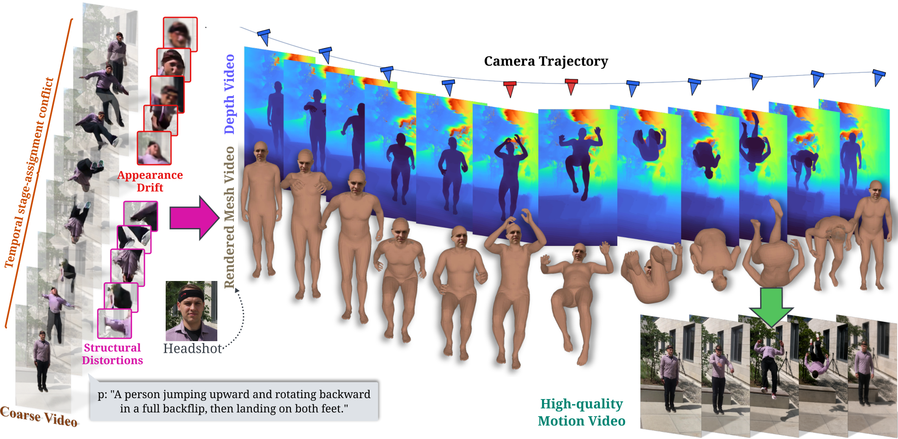

<h1 align="center">ReMoVe: Refining a Video Model's Own Motion for Coherent Human Video Generation</h1>

  Jie Li1,2,*,
  Muxin Pu3,
  Hongyi Cai4,
  Mingkang Dong5,
  Jianyuan Guo6,
  Tao Huang1,&dagger;

  1SJTU &nbsp;&nbsp;
  2USTB &nbsp;&nbsp;
  3Monash
   
  4UM &nbsp;&nbsp;
  5UQ &nbsp;&nbsp;
  6CityUHK
   
  *Work done during internship at SJTU.
  &dagger;Corresponding author.

  
  
  

  

## Getting Started

### 1. Environment

Requires Linux, CUDA, Conda, and at least one NVIDIA GPU.

~~~bash
git clone https://github.com/Lizruletheworld/ReMoVe.git
cd ReMoVe

bash setup/clone_tools.sh
bash setup/install_envs.sh
~~~

GVHMR and SMIRK are cloned into tools/. SAM3, Depth-Anything-3,
and Kimodo are installed as Python packages.

### 2. Model weights

~~~bash
bash scripts/download_model_weights.sh --source huggingface
~~~

This downloads the Wan2.2-TI2V-5B base model, the ReMoVe
LoRA + expanded patch-embedding weights, and the SAM3 BPE resource.

### 3. Coarse video

Generate a coarse video with the official Wan2.2 base model:

~~~bash
python scripts/coarse/generate_video.py \
  --image examples/lunges/head.jpg \
  --prompt "A person stepping one foot forward into a deep lunge, bending both knees, then pushing back to a standing position and repeating." \
  --output examples/lunges/coarse.mp4 \
  --height 704 --width 1280 --num_frames 81 --fps 24
~~~

### 4. ReMoVe inference

~~~bash
bash run_pipeline.sh \
  --video examples/lunges/coarse.mp4 \
  --prompt "A person stepping one foot forward into a deep lunge, bending both knees, then pushing back to a standing position and repeating." \
  --head examples/lunges/head.jpg \
  --work outputs/lunges
~~~

The input video can be generated by the coarse-video command or provided by the user.

### 5. Camera-controlled conditioning

~~~bash
python scripts/camera_control.py \
  --front_back_cache /path/to/mesh_cache.npz \
  --reference_video /path/to/rendered_mesh.mp4 \
  --preset dolly --distance_m -0.5 \
  --out_dir outputs/camera_control
~~~

## Training

### 1. Prepare training conditions

Motion-X++ videos and annotations are not included.

~~~bash
bash data_preparation/prepare_training_conditions.sh /data/MotionX++ 1
~~~

See data_preparation/README.md for supported categories and Motion-X++ data layout.

### 2. Build metadata

~~~bash
python data_preparation/build_training_metadata.py \
  --video-root /data/MotionX++/video \
  --mesh-root /data/MotionX++/mesh \
  --depth-root /data/MotionX++/depth \
  --captions /data/MotionX++/captions.json \
  --output /data/MotionX++/data.json
~~~

### 3. Train

~~~bash
bash training/train_remove.sh \
  --metadata_path /data/MotionX++/data.json \
  --output_dir outputs/train/mesh-depth
~~~

Use GPUS=4 before the command for four-GPU training.

## Additional assets

The following assets are not redistributed:

- GVHMR, SMIRK, SAM3, Depth-Anything-3, and Kimodo checkpoints;
- SMPL and SMPL-X body models;
- FLAME model;
- DECA assets used for face alignment.

Download them only from their official project pages. See
data_preparation/README.md for preprocessing details.

## License

ReMoVe is released under Apache-2.0. It uses GVHMR, SAM3, Depth Anything 3,
Kimodo, SMIRK, DECA, Wan2.2, SMPL, SMPL-X, and FLAME, each under its own
license.
